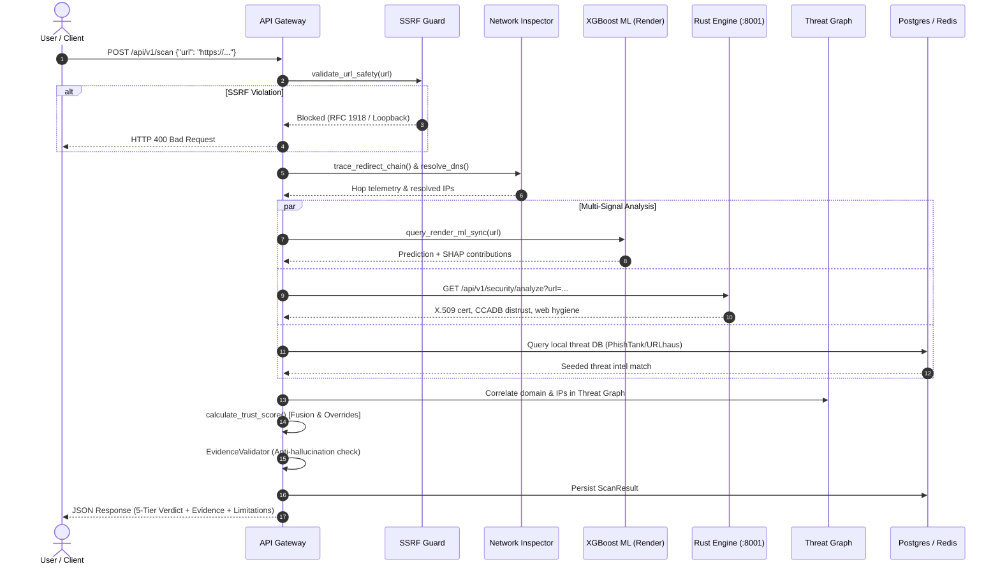

# TrustLens System Architecture Specification

## 1. Architectural Overview

TrustLens is a decentralized, multi-engine cybersecurity intelligence platform designed for automated phishing triage, TLS/cryptographic inspection, scam message analysis, and verifiable threat anchoring on the Ethereum blockchain.

The system is organized into modular services coordinated by an API Gateway:

```mermaid
graph TD
    Client["Client Layer (Next.js Web / Telegram Bot / Extensions)"] -->|HTTPS / REST| Gateway["TrustLens FastAPI Gateway (:8000)"]
    Gateway -->|Safe Socket Connect| NetInspect["Network Inspector (DNS / Multi-Hop Redirect Tracer)"]
    Gateway -->|Local REST (:8001)| RustCore["Rust Security Engine (:8001)"]
    Gateway -->|HTTPS Remote Sync| RenderML["XGBoost ML Engine (Render Cloud)"]
    Gateway -->|Embedded In-Process| ThreatGraph["Deterministic Threat Graph & DB"]
    Gateway -->|PostgreSQL / Redis| Storage["PostgreSQL 15 & Redis 7"]
    Client -->|Direct JSON-RPC (Alchemy)| Web3["Ethereum Sepolia Smart Contract Registry"]
```

---

## 2. Component Specifications

### 2.1 FastAPI Gateway (`trustlens/gateway`)
- **Port:** `8000` (Docker / Local)
- **Primary Routes:**
  - `POST /api/v1/scan` or `POST /scan`: End-to-end website investigation pipeline.
  - `POST /api/v1/analyze` or `POST /analyze`: SMS, WhatsApp, and email social-engineering analysis.
  - `GET /api/v1/reports`: Community threat report registry.
  - `POST /api/v1/reports/vote`: Decentralized reputation consensus voting.
  - `GET /health`: Operational health check.
- **SSRF Boundary Guard:** Validates all destination hostnames and IP addresses against RFC 1918 private subnets, cloud metadata (`169.254.169.254`), loopbacks (`127.0.0.1`, `::1`), and non-HTTP protocols before connection.
- **Fusion Engine:** Synthesizes lexical flags, remote XGBoost ML probabilities, Rust cryptographic findings, and threat intelligence with deterministic hard overrides.

### 2.2 Rust Security Engine (`trustlens/engines/security_engine`)
- **Port:** `8001` (Docker / Local)
- **Primary Routes:**
  - `GET /api/v1/security/analyze?url=...`: X.509 certificate chain inspection, CCADB distrust matching, web hygiene headers, passive mixed-content DOM scanner.
  - `POST /canonicalize`: RFC 8785 JSON Canonicalization Scheme (JCS) processor and Keccak-256 hasher.
  - `GET /health`: Operational health check.
- **Cryptographic Linters:**
  - **Fermat Factorization Sieve:** Detects close-prime RSA moduli ($|p - q| < 2^{n/4}$).
  - **CCADB Subordinate CA Linter:** Distrusts compromised intermediate authorities (e.g., eMudhra CCADB subordinate incident).

### 2.3 Phishing ML Engine (`trustlens/engines/phishing`)
- **Deployment:** Live on Render at `https://hackmatrix-adamas.onrender.com/predict`
- **Model Architecture:** 26-feature XGBoost Tree Model trained on authoritative phishing datasets.
- **Explainability:** SHAP TreeExplainer outputs directional feature contributions (e.g. `is_https`, `dot_count`, `entropy`).

### 2.4 Telegram Cyber-Threat Bot (`trustlens/bot`)
- **Runtime:** Python 3.11 asynchronous polling service.
- **Commands:** `/start`, `/scan <url>`, `/analyze <text>`, `/verify <0xhash>`, `/help`.
- **Safety Rule:** Operates under positive evidence guidelines; never labels clean targets as "Safe", returning `"No indicators found"` with disclaimers.

### 2.5 Decentralized Web3 Registry (`trustlens/contracts`)
- **Smart Contract:** `TrustLensRegistry.sol` (Solidity 0.8.20).
- **Network:** Ethereum Sepolia Testnet.
- **Contract Address:** `0x4b791449348d61B4f80FaA2B99a6111f1E8b6e6F`.
- **Pre-Image Security:** Stores only immutable 32-byte `bytes32` hashes. Zero sensitive PII is stored on-chain.

---

## 3. End-to-End URL Scan Sequence Flow



---

## 4. RFC 8785 Canonicalization & Independent Verification Pipeline

To ensure tamper-proof integrity across heterogenous environments, TrustLens standardizes all report hashing on **RFC 8785 (JSON Canonicalization Scheme)** and **Ethereum Keccak-256**:

```
[Threat Investigation Dossier]
               │
               ▼
   [Strip Transient Fields]  (tx_hash, block_number, on_chain_registration)
               │
               ▼
     [Lexicographical UTF-16 Key Sorting]
               │
               ▼
   [Deterministic JSON String (No Whitespace)]
               │
               ▼
       [Keccak-256 Hasher]
               │
               ▼
    0x<64_hex_digits>  (Solidity bytes32)
```

Cross-language conformance is guaranteed by identical test vector validation in Rust (`tests/canonical.rs`), Python (`tests/test_canonical.py`), and TypeScript (`frontend/src/lib/web3/canonicalJson.ts`).
