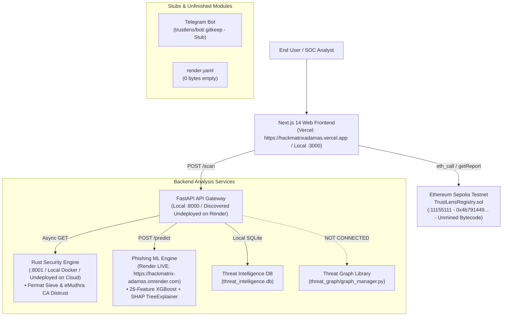
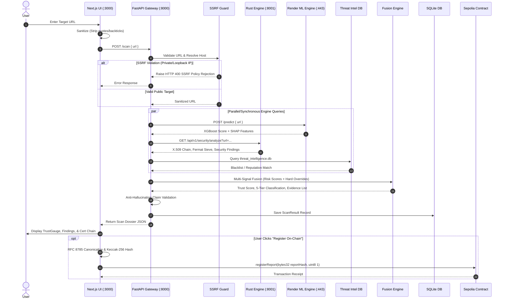

# TrustLens Architecture As Found (Discovery Phase Audit)
**Date:** November 2026  
**Auditor:** Senior Full-Stack, Security & QA Engineer  
**Branch:** `release/hardening-and-handbook-compliance`

---

## 1. System Topology & Microservices

---

## 2. Microservice Inventory & Actual State vs Deployment Map

| Service | Intended Location | Found State in Codebase | Telemetry / Verification |
| :--- | :--- | :--- | :--- |
| **Phishing ML Engine** | Render | **Deployed & Live** on Render (`https://hackmatrix-adamas.onrender.com`) | `HTTP 200` on `GET /` (`{"status":"healthy","engine":"TrustLens ML Model"}`). Tested live `POST /predict`. |
| **Frontend** | Vercel | **Deployed & Live** on Vercel (`https://hackmatrixadamas.vercel.app`) | `HTTP 200`. Linked to project `prj_b0owbL3GcKoD9c79BnAyTICGgogx`. |
| **FastAPI Gateway** | Render Web Service | **Undeployed to Cloud** (Local only on `:8000`) | `render.yaml` is 0 bytes. Dockerfile present. Defaults to `http://localhost:8000`. |
| **Rust Security Engine** | Dockerized Cloud Service | **Undeployed to Cloud** (Local only on `:8001`) | Standalone Dockerfile and Cargo build working. Defaults to `http://localhost:8001`. |
| **Smart Contract** | Ethereum Sepolia | **Undeployed to Public Sepolia** (Hardhat local only) | Bytecode at `0x4b791449348d61B4f80FaA2B99a6111f1E8b6e6F` is `"0x"`. Needs Sepolia deploy. |
| **Threat Graph** | Embedded in Gateway | **Disconnected / Unused Library** | Code exists in `trustlens/threat_graph/`, but is **never imported or invoked** in `scan.py`. |
| **Telegram Bot** | Cloud Daemon / Webhook | **Stub Only** (`trustlens/bot/.gitkeep`) | Completely unwritten. No token, no bot script. |

---

## 3. Inter-Service Communication & Call Graph

1. **Frontend to Gateway:**
   - Client sends JSON payload `{"url": target}` to `${NEXT_PUBLIC_API_URL:-http://localhost:8000}/scan`.
   - Timeout configured to 60s to account for potential cold starts.
   - If unreachable, falls back to pre-computed deterministic scenario fixtures.

2. **Gateway to Rust Security Engine:**
   - Synchronous or asynchronous HTTP `GET` to `${SECURITY_ENGINE_URL:-http://rust_security:8001/api/v1/security/analyze}?url={target}`.
   - If the Rust engine is unreachable, the gateway executes `run_native_fallback_security(target)` in Python via raw SSL socket connections.

3. **Gateway to Render ML Engine:**
   - HTTP `POST` to `${RENDER_ML_URL:-https://hackmatrix-adamas.onrender.com/predict}` with `{"url": target}`.
   - 45s HTTP client timeout with graceful fallback to in-process Python lexical heuristic classifier.

4. **Gateway to Threat Database:**
   - Direct SQLite connection to `threat_intelligence/threat_intelligence.db`.
   - Queries `threat_domains` table for domain matches.

5. **Frontend to Web3 Contract:**
   - Read queries executed via JSON-RPC `eth_call` to `${NEXT_PUBLIC_SEPOLIA_RPC:-https://ethereum-sepolia.publicnode.com}` querying `getReport(bytes32 reportHash)`.
   - Write transactions initiated through injected EIP-1193 provider (MetaMask) calling `registerReport(bytes32 reportHash, uint8 reportType)`.

---

## 4. Environment Variables Reference

| Environment Variable | Service | Default Value in Code | Purpose |
| :--- | :--- | :--- | :--- |
| `NEXT_PUBLIC_API_URL` | Frontend | `http://localhost:8000` | Gateway base URL |
| `NEXT_PUBLIC_CONTRACT_ADDRESS`| Frontend | `0x4b791449348d61B4f80FaA2B99a6111f1E8b6e6F` | On-chain registry address |
| `NEXT_PUBLIC_SEPOLIA_RPC` | Frontend | `https://ethereum-sepolia.publicnode.com` | Public Sepolia RPC URL |
| `PORT` | Gateway / ML / Rust | `8000` (Gateway/ML), `8001` (Rust) | Listening port |
| `DATABASE_URL` | Gateway | `sqlite:///./trustlens.db` | Primary application DB |
| `SECURITY_ENGINE_URL` | Gateway | `http://rust_security:8001/api/v1/security/analyze` | Rust Crypto Engine endpoint |
| `RENDER_ML_URL` | Gateway | `https://hackmatrix-adamas.onrender.com/predict` | Cloud ML Predictor endpoint |
| `DISTRUSTED_CA_PATTERNS` | Rust / Gateway | `emudhra,symantec,wosign,startcom` | Blacklisted CA substrings |
| `SEPOLIA_RPC_URL` | Contracts | `https://rpc.sepolia.org` | Deployment RPC URL |
| `SEPOLIA_PRIVATE_KEY` | Contracts | None | Deployer private key |
| `TELEGRAM_BOT_TOKEN` | Bot (Stub) | None | Telegram Bot API token |

---

## 5. API Routes Inventory

### A. FastAPI Gateway (`trustlens/gateway`)
* `GET /`: Health / Welcome info.
* `GET /health`: Health status check.
* `POST /scan` & `POST /api/v1/scan`: Primary URL investigation pipeline.
* `GET /scans`: Retrieve past 50 scan records.
* `GET /scan/{scan_id}`: Retrieve single scan by ID.
* `POST /report`: Submit user/community threat report.
* `GET /reports`: List community threat reports.
* `POST /vote/{report_id}`: Cast consensus vote on a threat report.
* `GET /votes/{report_id}`: Fetch voting consensus on a report.
* `GET /export/json`: Export reports as JSON.
* `GET /export/csv`: Export reports as CSV.
* `GET /export/stix`: Export indicators as STIX 2.1 JSON bundle.
* *(Note: Missing `POST /analyze` for Scam Message Analysis).*

### B. Phishing ML Engine (`trustlens/engines/phishing/model/models`)
* `GET /`: Health check (`{"status":"healthy","engine":"TrustLens ML Model"}`).
* `POST /predict`: Accepts `{"url": "..."}`, returns `prediction`, `malicious_probability`, and SHAP `explanations`.

### C. Rust Security Engine (`trustlens/engines/security_engine`)
* `GET /health`: Health status.
* `GET /scan`: Endpoint ping.
* `GET /api/v1/security/analyze`: Deep TLS, certificate chain, Fermat RSA sieve, and header inspection.

---

## 6. End-to-End Data Flow for One URL Scan

