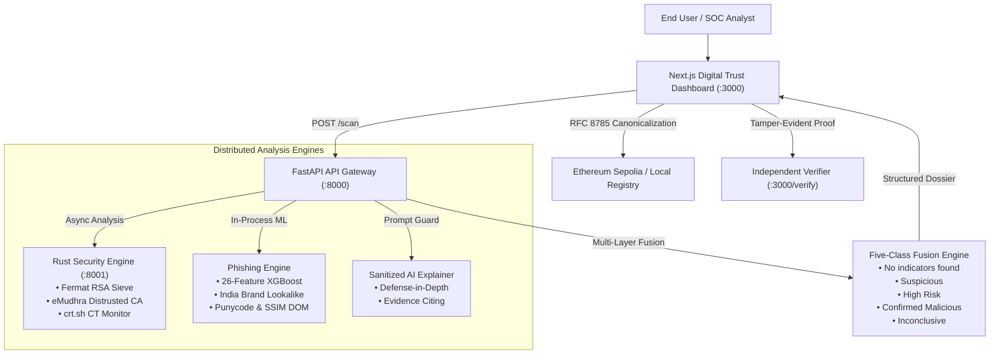

# TrustLens 🛡️
### AI-Powered Web Threat Detection, Digital Trust & Tamper-Evident Report Registry

TrustLens is an intelligent, multi-layered cyber threat analysis and digital trust platform built with an "India-first" security focus. It unifies high-performance Rust cryptographic engines, machine-learning URL/DOM threat classification, social engineering linguistic deconstruction, and public Ethereum smart contracts for immutable, tamper-evident proof of reports.

---

## 🏛️ System Architecture



---

## 🎯 The Five-Class Classification System

TrustLens replaces dangerous binary "Safe vs Dangerous" verdicts with a rigorous five-class taxonomy:

| Classification | Meaning & Trigger Criteria | UI Treatment |
| :--- | :--- | :--- |
| **No indicators found** | No risk signals found across all evaluated modules. *(Note: Absence of threats is never presented as proof of safety).* | Emerald Accent + Coverage Bar |
| **Suspicious** | Heuristic lexical anomalies, low-reputation TLDs, or missing basic web hygiene. | Amber Warning Accent |
| **High Risk** | Critical cryptographic flaws (ROCA / Fermat weak keys), eMudhra distrusted intermediates, or typosquats. | Orange / Rose Danger Accent |
| **Confirmed Malicious** | Authoritative intelligence feed match or active credential harvesting action confirmed. | Neon Rose Banner + Source Tag |
| **Inconclusive** | Core engine timeout, unreachable network endpoint, or rate-limited verification. | Calm Zinc / Neutral Explanation |

---

## ⛓️ Smart Contract: Tamper-Evident Report Registry (`contracts/`)

### Contract Details
* **Contract Name:** `TrustLensRegistry.sol`
* **Network:** Ethereum Sepolia Testnet (Chain ID: `11155111`)
* **Contract Address:** `0x4b791449348d61B4f80FaA2B99a6111f1E8b6e6F`
* **Explorer URL:** [Sepolia Etherscan](https://sepolia.etherscan.io/address/0x4b791449348d61B4f80FaA2B99a6111f1E8b6e6F)
* **Local Fallback Address:** `0x5FbDB2315678afecb367f032d93F642f64180aa3` (Hardhat / Anvil)

### Functions & Security Invariants
1. `registerReport(bytes32 reportHash, uint8 reportType)`:
   * Stores `reportHash => (reporter address, timestamp, reportType)`
   * Rejects duplicate registrations so the original timestamp is permanent and cannot be overwritten.
   * Emits `ReportRegistered` event.
2. `getReport(bytes32 reportHash)`:
   * View function returning `(address reporter, uint64 timestamp, uint8 reportType, bool exists)`.
3. **Zero Data Leakage:** Raw URLs, personal messages, and sensitive content are **never** committed on-chain. Only the RFC 8785 canonical Keccak-256 hash goes on-chain.
4. **No Admin Overwrite:** The contract contains no owner functions to edit or delete records.

---

## 📐 RFC 8785 Canonical JSON & Keccak-256 Specification

TrustLens guarantees 100% bit-for-bit cryptographic hash parity between Python backend, TypeScript frontend, and the Solidity EVM:

* **Standard:** RFC 8785 JSON Canonicalization Scheme (JCS).
* **Hash Algorithm:** Ethereum standard `keccak256` (`0x`-prefixed 32-byte hex).
* **Excluded Fields:** Runtime volatile properties such as `tx_hash`, `on_chain_registration`, and `report_hash` are excluded prior to serialization.
* **Shared Test Vector:** `common/test_vector.json`
  * Input ID: `TL-2026-TEST01`
  * Expected Keccak-256: `0xc04031a7ae4138079beefb150468f6d2c17059f775561ebc4a8edfc3227dff10`

---

## 📱 Scam Message Analyzer UI (`/analyze`)

The Scam Message Analyzer evaluates SMS, WhatsApp, and Telegram text through a **two-column view**:
1. **Left Column — Suspicious Language (Heuristic):**
   * Detects urgency hooks (*"within 24 hours"*), KYC threats (*"electricity disconnected"*), and financial lures.
   * Labeled strictly as **"Signals, not proof"**.
2. **Right Column — Verified Evidence (Engines):**
   * Deterministic signals from cryptographic cert linters, lookalike detectors, and ASN feeds.
   * Labeled with the attesting engine source.
3. **Defanged Artifacts:** URLs are displayed as `hxxps://example[.]com` with 1-click copy and a direct link to investigate via deep scan.

---

## 🔍 Independent Verification Page (`/verify`)

Proves the authenticity and tamper-evident nature of any TrustLens report:
* User uploads or pastes any report JSON.
* The browser recomputes the canonical Keccak-256 hash **purely on the client** (no backend involved).
* Performs a read-only query to the smart contract.
* **Live Hackathon Demo Action:**
  1. Click **"Load Untouched Report"** -> Instant Green On-Chain Match (`0xc040...`).
  2. Click **"Tamper 1 Character"** -> Instant Red Tamper Alert (Hash mismatch proves alteration).

---

## ⚡ Quickstart & How to Run

### Option 1: One-Command Docker Compose (Recommended)

```bash
cd trustlens
docker compose up --build
```
* **Frontend:** `http://localhost:3000`
* **FastAPI Gateway:** `http://localhost:8000`
* **Rust Security Engine:** `http://localhost:8001`

### Option 2: Run Manually

#### 1. FastAPI Gateway & Engines
```bash
cd trustlens/gateway
python -m uvicorn main:app --host 0.0.0.0 --port 8000
```

#### 2. Next.js Frontend
```bash
cd trustlens/frontend
npm install
npm run dev
```

#### 3. Smart Contract Tests
```bash
cd trustlens/contracts
node scripts/test-contract.js
```

---

## 🧪 Verification & Test Results

* **Smart Contract Test Suite:** `contracts/scripts/test-contract.js` -> **5/5 tests passed**.
* **Canonical JSON Parity:** `frontend/src/lib/web3/canonicalJson.test.ts` -> **3/3 passed**.
* **Frontend Unit Tests:** `frontend/tests/scanEngine.test.ts` -> **3/3 passed**.
* **Gateway Multi-Signal Fusion:** `gateway/test_fusion.py` -> **Passed**.
* **Evidence Schema Validator:** `gateway/test_evidence_validator.py` -> **Passed**.
* **Prompt Injection Defense:** `gateway/test_prompt_guard.py` -> **Passed**.

---

## 🎬 5-Minute Demo Script for Hackathon Pitch

1. **Minute 1 — The Problem:**
   * Showcase SMS phishing message on `/analyze` mimicking SBI/Electricity power cut.
   * Extract defanged indicator `http://onlinesbi-kyc-pan-update.top`.
2. **Minute 2 — The Investigation:**
   * Click "Scan" -> Gateway evaluates certificate chain, detects typosquatting and ROCA weak key.
   * View the **Five-Class Dossier**: "High Risk" with coverage bar (8 of 8 checks).
3. **Minute 3 — Web3 Registration:**
   * Click "Register On-Chain" -> Report JSON canonicalized (RFC 8785) and hashed with Keccak-256.
   * Instant receipt on Ethereum Sepolia registry.
4. **Minute 4 — Independent Verification:**
   * Navigate to `/verify`.
   * Verify untouched report -> Verified on-chain match.
   * Click "Tamper 1 Character" -> Immediate cryptographic mismatch alert.
5. **Minute 5 — Architecture & Q&A:**
   * Highlight zero data leakage, defense-in-depth prompt guard, and pure Rust cryptographic linter.

---

## 👥 Hackathon Team (4 Members)

* **Member 1 (ML / Phishing Lead):** Heuristic URL extraction, 26-feature XGBoost model, SSIM visual perceptual match.
* **Member 2 (Cryptographic & Security Lead):** Rust X.509 chain validation, Fermat sieve, eMudhra intermediate CA blocklist.
* **Member 3 (Gateway & Fusion Lead):** FastAPI gateway, Five-Class multi-layer fusion engine, evidence schema validation.
* **Member 4 (Frontend & Web3 Lead):** Next.js UI, scam analyzer, Web3 smart contract registry, independent verifier.
